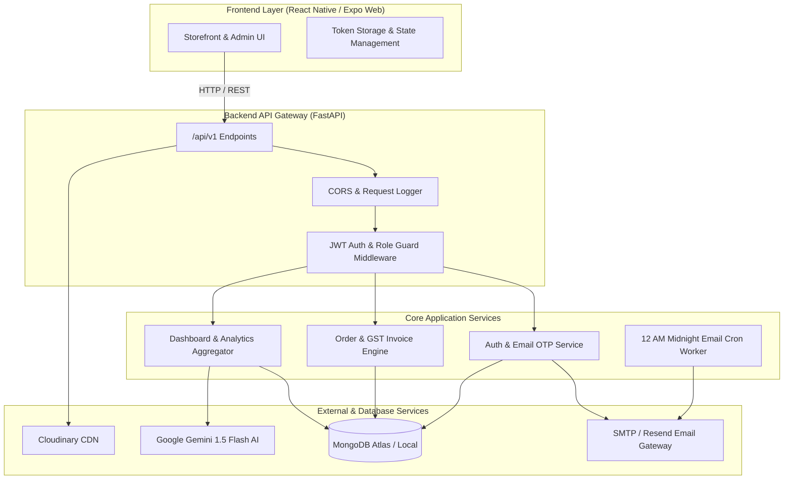

# 🎆 CloudCrackers

> **Enterprise-grade Festive Pyrotechnics Sales, Inventory Management & Analytics Platform (Android + Web)**

[](https://fastapi.tiangolo.com/)
[](https://reactnative.dev/)
[](https://www.mongodb.com/)
[](https://www.docker.com/)
[](https://github.com/features/actions)
[](https://opensource.org/licenses/MIT)

🔗 **[Live Demo](https://cloudcrackerfinalyearproject-1.onrender.com)** | 📄 **[API Docs (Swagger)](https://cloudcrackerfinalyearproject-1.onrender.com/docs)** | 📱 **[Download APK (EAS Build)](#download-apk)**

> ⏳ **Note on Cold Starts:** The backend is hosted on Render's free tier. If the instance is sleeping, the first request may take approximately 30–50 seconds to spin up.

---

## 📸 Screenshots

| Customer Storefront | Interactive Cart & Checkout | Admin Analytics Dashboard |
| :---: | :---: | :---: |
| *(Add `screenshots/home.png`)* | *(Add `screenshots/cart.png`)* | *(Add `screenshots/admin_dashboard.png`)* |

| Daily Sales & Category Distribution | Gemini 1.5 Flash AI Copilot | Inventory & Stock Alert Guardrails |
| :---: | :---: | :---: |
| *(Add `screenshots/sales_report.png`)* | *(Add `screenshots/ai_copilot.png`)* | *(Add `screenshots/inventory.png`)* |

---

## 🚀 Features

### 🛒 Customer Storefront
* **Product Catalogue & Smart Filters:** Filter by categories (Sparklers, Aerial Fireworks, Ground Chakkars, Gift Boxes), sound levels, and green cracker eco-certifications.
* **Wishlist & Cart Sync:** Persistent shopping cart with stock-exceed limits and dynamic price/discount calculations.
* **Hybrid AI Customer Chatbot:** Dual-engine assistance with rule-based festive FAQs and generative fallback via Google Gemini 1.5 Flash.
* **Dynamic UPI QR & UTR Verification:** Seamless zero-gateway-fee checkout generating instant UPI payment intents and UTR tracking.
* **Diwali Loyalty Rewards:** Automated promotional discount coupons sent directly to registered emails for festival seasons.
* **Order History & GST Invoicing:** Real-time order progress timeline with instant 18% GST invoice generation.

### 🛡️ Admin & Store Operations
* **Executive Real-time Dashboard:** Today's vs. Total Revenue metrics, order status breakdowns, and SVG category distribution charts.
* **Automated Midnight Sales Reports:** Background cron job running daily at 12:00 AM to aggregate sales data and email comprehensive summaries to store administrators.
* **Real-time Inventory Management:** Instant stock alerts (Low Stock threshold `< 5`, Out of Stock badges, and restock actions).
* **Payment & UTR Verification:** Admin approval portal to verify user-submitted UPI UTR reference codes against bank ledger entries.
* **OTP-Secured Admin Elevation:** Critical administrative operations (promoting or removing admin users) require mandatory OTP email verification.

---

## 📊 Data Mining & Predictive Analytics

| Algorithm | Business Use Case |
| :--- | :--- |
| **Apriori Algorithm** | Frequent itemset mining for *"Frequently Bought Together"* cracker bundles and festive gift hampers. |
| **K-Means Clustering** | Customer segmentation (Festive Bulk Buyers, Family Shoppers, Premium Aerial Enthusiasts) for targeted campaigns. |
| **IQR (Interquartile Range)** | Anomaly detection flagging unusually high-value or abnormal order volumes for mandatory manual admin review. |
| **Linear Regression** | Seasonal trend analysis and festive-season sales volume projection based on historical multi-week order velocity. |

---

## 🛠️ Tech Stack

| Domain | Technologies |
| :--- | :--- |
| **Frontend** | React Native, Expo 51, React Native Web, TypeScript, React Navigation, Axios |
| **Backend** | FastAPI (Python 3.12), AsyncIO, Uvicorn, Pydantic v2, Motor / Beanie ODM |
| **Database** | MongoDB (Atlas Cloud & Local Replica fallback) |
| **AI / GenAI** | Google Gemini 1.5 Flash API (Natural language business insights & customer chat) |
| **Authentication** | JWT (JSON Web Tokens), Google OAuth 2.0, Native Passwordless Email OTP |
| **Media & Storage** | Cloudinary API (Compressed high-resolution product pyrotechnic imagery) |
| **DevOps & CI/CD** | Docker, Docker Compose, GitHub Actions CI Pipeline, Render Cloud Platform |

---

## 🏛️ System Architecture



---

## 💻 Run Locally

### Prerequisites
* Python 3.11+ or 3.12+
* Node.js 18+ or 20+
* MongoDB running locally on `mongodb://localhost:27017` (or Docker)

---

### Method A: Running with Docker Compose (Recommended)

```bash
# Clone the repository
git clone https://github.com/athilingam3336/cloudcrackers.git
cd cloudcrackers

# Start MongoDB and FastAPI Backend
docker compose up --build
```
The backend API will be available at `http://localhost:8000` and Swagger docs at `http://localhost:8000/docs`.

---

### Method B: Manual Setup

#### 1. Backend Setup
```bash
cd backend

# Create and activate virtual environment
python3 -m venv .venv
source .venv/bin/activate  # On Windows: .venv\Scripts\activate

# Install dependencies
pip install -r requirements.txt

# Configure environment variables
cp .env.example .env

# Run FastAPI development server
uvicorn app.main:app --reload --host 0.0.0.0 --port 8000
```

#### 2. Frontend Setup
```bash
cd frontend

# Install dependencies
npm install

# Configure environment variables
cp .env.example .env

# Start Expo Web & Mobile bundler
npx expo start
```
Press `w` in the Expo terminal to launch the web version in your browser (`http://localhost:8081`).

---

## 💳 Why UPI QR + UTR Verification Flow?

Standard Indian payment gateways (such as Razorpay, Cashfree, or Stripe) classify pyrotechnics and consumer fireworks under **Restricted / Prohibited Business Categories**, preventing direct credit card and payment gateway integration without specialized legal approvals.

To solve this industry-wide hurdle:
1. **Dynamic UPI Intent:** CloudCrackers dynamically generates standardized UPI payment strings and QR codes encoded with the merchant UPI ID, exact order total, and order reference ID.
2. **UTR Reference Input:** Upon completing payment via Google Pay, PhonePe, or Paytm, the customer inputs their 12-digit bank UTR (Unique Transaction Reference) number.
3. **Admin Verification Ledger:** Store administrators can verify the incoming bank credit against the submitted UTR code before transitioning the order to `Confirmed` and dispatching stock.

---

## 👤 Author

**M. Athi Lingam**
* 📧 Email: [athilingam3336@gmail.com](mailto:athilingam3336@gmail.com)
* 💼 LinkedIn: [linkedin.com/in/athilingam-m](https://www.linkedin.com/in/athilingam-m)
* 🐙 GitHub: [@athilingam3336](https://github.com/athilingam3336)

---

## 📄 License
This project is licensed under the MIT License - see the [LICENSE](LICENSE) file for details.

